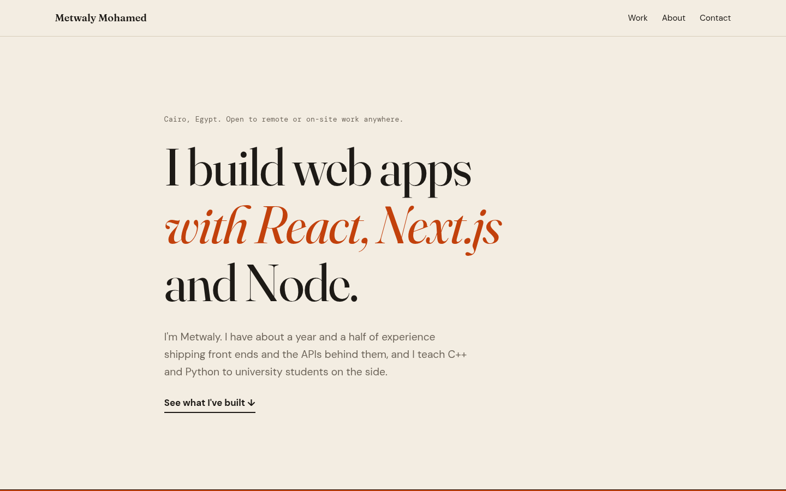
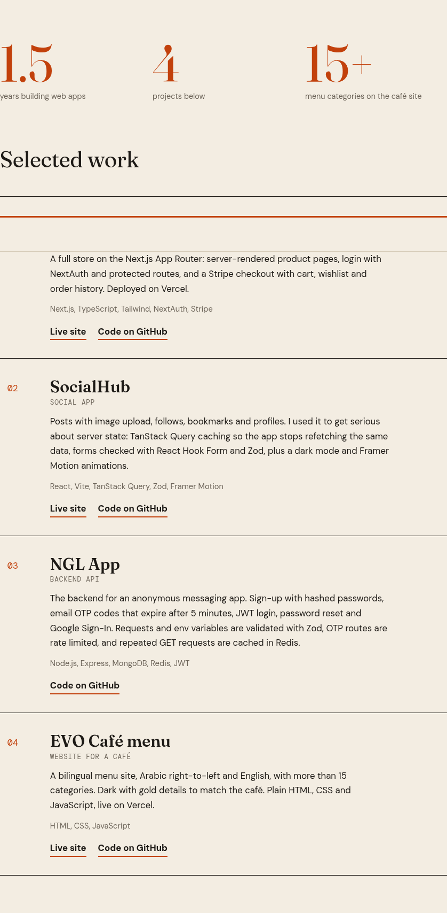
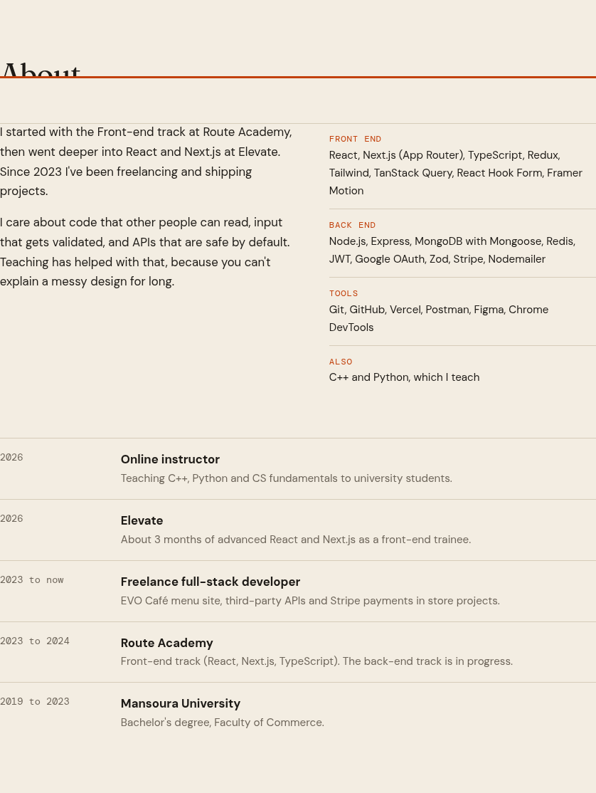
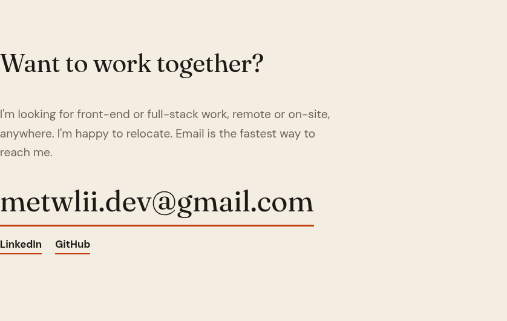

# Metwaly Mohamed — Portfolio

Personal portfolio built with **React 19**, **TypeScript**, **Vite** and **Framer Motion**: animated intro, scroll progress bar, cursor glow, staggered reveals and 3D tilt cards.

🔗 **Live:** [mtwlii.vercel.app](https://mtwlii.vercel.app)

---

## 📸 Screenshots

### Hero


### Selected work


### About


### Contact


---

## ✨ Features

- Animated intro sequence and staggered scroll reveals (Framer Motion)
- Scroll progress bar and cursor glow
- 3D tilt cards for the selected projects
- Project links to live demos and source code
- Responsive editorial layout with keyboard focus states and reduced-motion support

---

## 🛠️ Tech Stack

| Category | Technology |
|---|---|
| Framework | React 19 + Vite |
| Language | TypeScript |
| Animation | Framer Motion |
| Deployment | Vercel |

---

## 🚀 Getting Started

```bash
git clone https://github.com/Mtwlii/portfolio.git
cd portfolio
npm install
npm run dev      # http://localhost:5173
```

```bash
npm run build    # production build
npm run preview  # preview the build locally
```

---

## 📁 Project Structure

```
src/
├── features/        # hero, intro, projects, about, contact, navigation
│   └── <feature>/   # components, data, hooks, types per feature
└── shared/          # shared components and animation utilities
```

---

## 🗺️ Roadmap

- [ ] Add focused case studies for FreshCart, SocialHub, NGL App and EVO Cafe
- [ ] Add a downloadable CV and a working contact form
- [ ] Add a short technical blog section
- [ ] Run accessibility, responsive-layout, and Lighthouse checks before release
- [ ] Keep typography, spacing, color, and motion choices consistent as new sections are added

---

## 👤 Author

**Metwaly Mohamed**
- GitHub: [@Mtwlii](https://github.com/Mtwlii)
- LinkedIn: [mtwlii](https://www.linkedin.com/in/mtwlii/)
